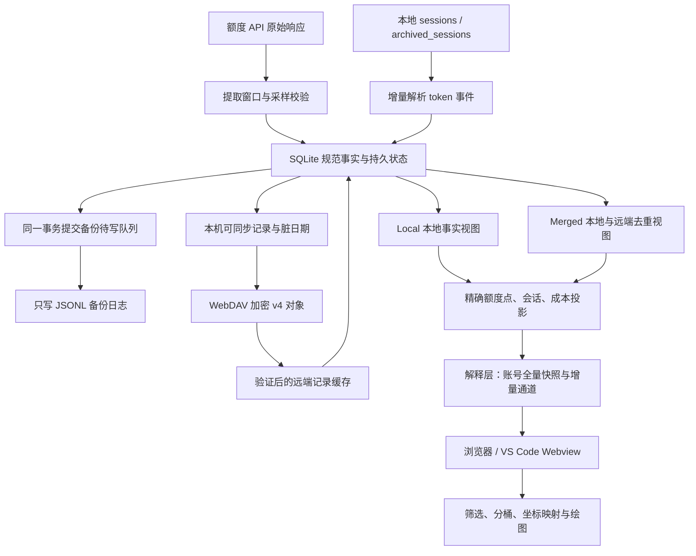

# 数据采集、持久化、云端合并与客户端展示

本文按“API / 本地 session → 本地事实记录 → 云端发布与下载 → Local / Merged → 后端展示数据 → 客户端处理与绘制”的顺序，说明 Codex Usage Monitor 的数据内容、格式、存储及优化方式。

依据：2026-10-30 当前实现。本地待发布合同为 20，已发布基线为 19；云端待发布合同为 5，已发布基线为 4。历史设计文档中的目标与版本描述不能替代当前代码和成功发布记录。

待发布本地合同 20 还将同步元数据、额度压缩元数据、token 合计和旧会话头的一对一字段并入 `sample_records`。`quota_windows` 按账号、来源设备、窗口和实际观测时间独立保存额度读数，由主记录的 `five_hour_id` / `seven_day_id` 引用。采集使用每个窗口自己的 `percentCheckedAt`；7d 更新不会推进仍沿用旧读数的 5h 时间。同一时间的局部更新保留另一个窗口。迁移保留原 payload、哈希、归属和有效投影，并在事务内验证后替换旧结构；历史记录缺少独立窗口时间时保留原时间。

## 1. 总体结构与职责



这里的 API 是 Codex 额度接口，本地 session 是 Codex 产生的会话日志；它们提供不同种类的事实。API 提供账号额度百分比和重置时间，本地日志提供事件级 token 消耗。项目据后者计算预估成本，不能仅凭额度百分比反推出精确 token 或账单。

Python 服务承担采集、归因、持久化、同步、去重及业务计算。浏览器和 VS Code Webview 消费后端准备的数据，并完成交互与绘制。WebDAV 是加密对象存储，当前没有云端计算服务负责生成 Merged。

服务运行后，即使没有打开客户端，也可以继续采样、扫描、同步和准备展示缓存。客户端启用时读取已准备的全量快照，随后接收增量；时间范围和指定日期在客户端裁剪。不能把“打开客户端”理解为每次都从原始 session 开始重算。

### 数据层次

| 层 | 内容 | 主要作用 | 能否直接替代原始事实 |
| --- | --- | --- | --- |
| 原始输入 | API 响应、Codex session JSONL | 提供采样来源与上下文 | 是输入来源；API 完整响应不再写入诊断采样日志 |
| 规范事实 | 额度读数、token 事件与已计算成本 | 本地业务历史、恢复与同步基础 | 是当前规范历史 |
| 同步持久状态 | 本机记录的收集期、远端已验证记录与归属 | 稳定发布、恢复和跨设备合并 | 部分不可仅从本地 JSONL 等价重建 |
| 业务投影 | Local / Merged 的额度点、会话、成本区间 | 统一业务口径、加速查询 | 可由保留事实重建 |
| 交付缓存 | 类型化解释数据、全量 JSON/gzip 快照、独立序列日志 | 减少接口开销与传输量 | 可重建，不应回写成事实 |
| 客户端状态 | 所选范围、筛选项、块缓存、图形状态 | 交互与绘制 | 不能作为持久业务数据来源 |

## 2. 采样来源及规范化

### 2.1 API 额度采样

`monitor_quota.py` 使用登录凭据请求额度 API，识别响应中不同命名方式的百分比、窗口时长和重置时间，提取 `5h` 与 `7d` 窗口。`monitor_history.py` 进一步生成统一的额度读数。

采样需要区分请求完成时间、实际采用的额度测量时间、是否沿用上一份有效窗口，以及异常读数的仲裁结果。请求失败或窗口缺失不能凭空生成一次有效的零额度读数。内部为缺失窗口构造的占位值带有 `unavailable`，规范事实生成时会排除该窗口。

账号轮询按用量身份去重：多个本地登录槽对应同一用量账号时，只采一份；存在活动槽的账号使用活动轮询，其他账号使用非活动轮询和可用凭据。这样可以减少请求，也避免同一账号被不同凭据重复计入。

### 2.2 本地 session 扫描

默认扫描 `CODEX_HOME/sessions` 及 `CODEX_HOME/archived_sessions` 中的 JSONL；`CODEX_HOME` 未指定时使用 `~/.codex`。采集器关注：

| session 事件 | 使用内容 |
| --- | --- |
| `session_meta` | 会话身份、是否携带继承历史等信息 |
| `turn_context` | 当前模型及服务档位上下文 |
| `event_msg` / `token_count` | `total_token_usage`、`last_token_usage` 及事件时间 |

原始日志的 token 数可能是累计值。解析器通常用本次累计值减前次累计值得到增量；首次记录、累计回退、继承历史等情况会采用专门的回退规则，避免把继承的全部历史当作本次新增。缓存输入等分项也会进行边界校验。

解析后生成稳定 `eventId`，并保留会话、时间、模型、档位、token 增量及来源信息。事件身份不单纯依赖文件路径，因此重复副本或归档移动不应重复记账。文件截断、内容替换、迟到事件需要校验或协调重算；已经写入规范账本的事实不会因原始文件消失就自动全部删除。

### 2.3 账号归因与预估成本

事件按其发生时间查找账号激活时间线，确定当时的登录槽和账号归属。后续展示和去重使用稳定的用量账号身份，账号名称只作标签。

成本由事件 token、模型、服务档位及事件时间适用的价格规则计算，并写进账本。账本保存已计算的成本，后续展示不应随意用当前价格重算全部历史。它是基于日志和项目价格规则的估算值，不等同于服务商结算账单。

## 3. 核心记录内容与格式

以下 JSON 展示字段结构；示例账号、事件、哈希和模型名称均为占位值。带 `<...>` 的占位符不能直接通过生产校验。时间字符串采用带时区的 ISO 8601，跨设备分片统一使用 UTC。

### 3.1 额度读数

```json
{
  "checkedAt": "2026-10-26T02:05:00Z",
  "accountSlotId": "slot-a",
  "accountLabel": "工作账号",
  "windows": {
    "5h": {"usedPercent": 24.5, "resetAt": "2026-10-26T06:00:00Z", "plan": "plus"},
    "7d": {"usedPercent": 62.0, "resetAt": "2026-10-30T00:00:00Z", "plan": "plus"}
  },
  "sync": {
    "version": 1,
    "originMachineId": "machine-a",
    "accountId": "usage-account-a",
    "recordId": "<额度记录身份的 SHA-256>"
  }
}
```

`usedPercent` 表示已使用百分比。规范记录只包含有效窗口，不要求每条同时有两个窗口。`resetAt` 可以缺失，未知不应被解释为没有重置。`plan` 用于套餐归一化和连续性判断。

`accountSlotId` 是本地凭据槽，`sync.accountId` 是同步与去重的用量身份，`originMachineId` 是记录来源机器。三者承担不同职责，不能互换。额度记录的 `recordId` 由账号身份和测量时间生成；具体逻辑键为 `quota:<recordId>`。

当前不再保存旧 `compaction` 元数据；待发布的本地契约 20 和云端契约 5 负责清理。历史诊断采样日志曾包含更丰富的请求、仲裁和运行信息；当前版本不再生成该日志，已有文件保留。

### 3.2 token 事件账本

当前规范账本为 `schemaVersion: 2`，正常新增记录的 `recordType` 为 `usage`：

```json
{
  "schemaVersion": 2,
  "recordType": "usage",
  "eventId": "<稳定事件 ID>",
  "occurredAt": "2026-10-26T02:04:42Z",
  "sessionId": "session-a",
  "rawModel": "<事件模型键>",
  "billingModel": "<归一化计价模型键>",
  "serviceTier": "default",
  "accountSlotId": "slot-a",
  "accountLabel": "工作账号",
  "tokens": {
    "inputTokens": 1200,
    "freshInputTokens": 900,
    "cachedInputTokens": 200,
    "cacheWriteInputTokens": 100,
    "outputTokens": 300,
    "totalTokens": 1500,
    "requests": 1
  },
  "cost": {
    "inputCostUsd": 0.0018,
    "cachedInputCostUsd": 0.00004,
    "cacheWriteInputCostUsd": 0.0002,
    "outputCostUsd": 0.003,
    "totalCostUsd": 0.00504
  },
  "sync": {"version": 1, "originMachineId": "machine-a", "accountId": "usage-account-a"}
}
```

示例成本仅用于说明字段关系，不代表某个真实模型价格。`inputTokens` 包括新鲜输入与缓存相关输入，不能再把各输入分项叠加到输入总数上。`serviceTier` 规范为 `default` 或 `fast`；部分记录还保存 `sourceFile` 供来源追踪。

逻辑键为 `tokenLedger:usage:<accountId>:<eventId>`。同一会话中会有多条事件，不能只用 `sessionId` 去重，也不能把会话累计总数逐条相加。

运行时只接收当前格式的 `usage` 事件，不混合读取 `legacyBaseline` / `sessionBaseline` 或 `sourceCoverage` / `sourceTotals`。合同 20 在迁移阶段利用 SQLite 保留的原始事件重建可转换记录，无法确定完整事件或账号归属的旧记录直接丢弃。没有原始事件的历史累计量不再贡献 token/cost。旧格式解码仅用于已发布的顺序迁移步骤。

### 3.3 四种时间与身份

| 字段 | 含义 | 主要用途 |
| --- | --- | --- |
| 额度 `checkedAt` | 额度测量时间 | 额度排序、周期判断 |
| 事件 `occurredAt` / 信封 `eventAt` | 业务事件时间 | 成本统计和图表归属 |
| `collectionPeriod` | 记录首次进入本机发布索引的 UTC 半小时 | 稳定云端分片 |
| manifest `builtAt` | 展示清单构建时间 | 缓存诊断，不是业务发生时间 |

例如今天才发现昨天的 token 事件，成本仍归昨天；首次正常收集时的云端分片可以属于今天。历史初始化缺少收集时间时，使用历史事件时间回填。后续修正同一逻辑键保留已有收集期，不因修改而移动分片。

## 4. 本地数据存储

### 4.1 文件布局

默认数据目录为 `~/.codex-switch`，Windows 通常为 `C:\Users\<用户名>\.codex-switch`。命令行指定历史文件路径后，关联路径会据此派生，不能假设所有部署都使用以下默认名称。

| 文件或目录 | 角色 | 保留 / 恢复要求 |
| --- | --- | --- |
| `usage_monitor_quota_readings.jsonl` | 只写额度备份日志 | 不参与正常读取、修复或同步 |
| `usage_monitor_token_events.jsonl` | 只写 token 与成本备份日志 | 修正追加普通记录；数据库删除不写入日志 |
| `usage_monitor_state.json` | 兼容状态输出 | 不再作为迁移或重启的数据来源；从 SQLite 恢复 |
| `usage_monitor_sync_cache-v4.sqlite3` | 规范事实、同步持久状态、业务投影与交付缓存 | 活跃用量数据的权威来源，必须备份 |
| `usage_monitor_sync_cache.json` 及关联旧缓存 | 兼容历史同步缓存 | 旧 peer 数据在对应 v4 来源生效前可作临时来源 |
| `accounts/` | 本地账号管理、凭据与归因相关状态 | 与用量事实分工保存，备份注意敏感性 |

`usage_monitor_history.jsonl`、旧 token-session 文件和 dashboard JSON 缓存等名称仍可能出现在兼容、迁移及路径派生代码中，不应把它们都认定为当前主要事实文件。

### 4.2 为什么同时使用 JSONL 与 SQLite

SQLite 是活跃用量数据的权威数据库。Python 采集逻辑直接读取原始 Codex session 文件、执行解析和归因，再写入 SQLite；数据库本身不追踪文件。`monitor_ingestion.py` 管理源文件发现、增量解析与纠错，`monitor_processing.py` 管理数据库访问和事务处理状态。

JSONL 仅作只写备份日志，用于人工分析和显式恢复。额度、token 与成本事实提交时，同一 SQLite 事务将备份内容放入 `processing_backup_queue`，由 `monitor_backup.py` 独立追加。正常启动、查询、同步、账号改名、修复和源文件替换处理均不读取 recorder JSONL。删除、截断或修改备份文件不会改变数据库中的活跃数据。

合同 19 假定现有 SQLite 数据完整，仅转换数据库中的本地来源身份并完成已有数据库处理状态，保留收集期、远端记录和解析状态。该迁移不读取 JSONL 或旧状态文件，不用备份日志补齐或替换数据库事实；回滚备份仅覆盖数据库。人工重建由外部工具或人员负责，本程序不提供恢复读取器、重放规则或人工重建命令。

### 4.3 SQLite 逻辑表与视图的职责

下表按业务查询名称列出职责；在新增类型化布局中，`local_records`、`remote_records`、`processing_facts` 是兼容读取视图，其余表按各自用途继续存在。

| 表族 | 主要内容 |
| --- | --- |
| `local_records` | 本机发布逻辑键、固定收集期、内容哈希和同步记录 |
| `remote_days` / `remote_records` / `remote_origins` | 已验证远端日期、布局、记录及 v4 来源状态 |
| `processing_blocks` | 原始 session 文件校验信息；不追踪备份日志 |
| `processing_backup_queue` | 同一事务提交的备份待写记录；追加成功后确认 |
| `processing_scan_sources` / `processing_scan_events` / `processing_occurrences` | session 解析检查点、事件队列和文件出现关系 |
| `processing_facts` | 权威规范事实视图，带来源、账号、会话、事件时间和 JSON |
| `processing_coverage` / `processing_ledger_order` / `processing_meta` | 覆盖水位、处理顺序、待发送通知和修订状态 |
| `processing_effective` / `processing_ledger_sessions` / `processing_totals` | 有效去重事件及增量汇总 |
| `processing_dirty` / `processing_changes` / `processing_dirty_days` | 待更新的业务范围与待发布日期 |
| `processing_quota_points` / `processing_display` / `processing_cost_ranges` | 精确额度点、会话、事件成本和成本额度区间 |
| `processing_sampled_quota` | 后端逐窗口处理结果，保留原始值与接受值；拒绝值为 null |
| `dashboard_days` / `dashboard_parts` / `dashboard_day_meta` | 展示日期分区修订、精度层级与精确汇总元数据 |
| `dashboard_blobs` / `dashboard_manifests` / `dashboard_rollups` | 不可变 JSON/gzip 块、范围清单和多日聚合缓存 |

表名包含 cache 并不意味着整库可以删除。特别是 `local_records.period`、远端事实、来源身份和未完成恢复批次必须保存。正常修复应定向失效派生索引，由保留事实重建。

### 4.4 写入顺序与恢复

SQLite 使用 WAL，让读取已提交状态与短写事务协作。JSONL 和 SQLite 是两个存储介质，不能假设一条 SQLite 事务可以同时原子提交二者。

token 增量处理在同一 SQLite 事务中提交账本记录、源事件确认、覆盖水位、通知与备份待写内容，不再额外保存准备批次。合同 19 迁移一次性完成旧运行时遗留的准备批次。额度同样直接提交数据库中的原始读数及备份队列。日志写入失败不阻断已提交的数据，重启后继续重试待写内容。

备份日志只以追加方式打开，不读取、修补尾行或原子替换。每个批次前写入换行符隔离损坏尾行，随后 flush/fsync。修正以相同身份追加普通新版本；数据库删除不追加操作记录，也不修改已有日志。显式重建时由当前预处理和处理逻辑决定保留哪些记录。若 fsync 后、队列确认前中断，备份中可能重复投递；显式恢复按身份重放即可去重。原始 Codex session 文件仍由采集代码处理截断、替换和中断，与备份文件相互独立。

### 4.5 工作区新增的类型化采样存储

`monitor_sample_store.py` 将 SQLite 中重复保存的采样载荷收敛为共享记录。这里改变的是 SQL 物理布局与访问方式，本地 JSONL 只写备份及云端 v4 格式仍按各自边界保存。

| 物理表族 | 保存内容 |
| --- | --- |
| `sample_records` | 记录种类、schema、事件时间、会话、模型、内容哈希及公共字段 |
| `quota_samples` / `quota_windows` | 额度压缩元信息、5h / 7d 百分比、重置时间及套餐 |
| `token_samples` | token 整数列与成本数值列 |
| `sample_sync` | 来源设备、用量账号、记录 ID 与同步标记 |
| `baseline_sessions` / `baseline_models` / `baseline_tiers` | 仅供顺序迁移解码旧会话基线；合同 20 清理其有效数据，当前计算不读取 |
| `sample_accounts` / `sample_devices` / `sample_sources` 等维表 | 重复账号、设备、来源、会话、模型、套餐、档位字符串的整数引用 |
| `processing_fact_refs` | 来源与位置到共享采样记录的引用，并保存处理索引和本地归因 |
| `local_record_refs` | 发布逻辑键、稳定收集期、内容哈希到共享记录的引用 |
| `remote_record_refs` | 远端机器 / 日期 / part、信封元信息到共享记录的引用 |

共享记录按剥离本地槽 / 标签后的种类和载荷内容寻址；归因信息单独保存在引用上。因此同一载荷不必在事实索引、本机发布索引及远端记录中重复储存整份 JSON，也不会因本地显示名不同就复制整个载荷。

已知字段使用类型化列；presence / null / float / bool 掩码区分缺失、显式 null、数值表示和布尔值。未知扩展字段或非预期类型保留在扩展载荷，未知记录可保留 opaque JSON，避免为了列类型强制转换而丢数据。因而“类型化”不等于所有内容都完全没有 JSON。

`processing_facts`、`local_records`、`remote_records` 视图通过连接注册的函数重建兼容 JSON，写入经仓储函数更新物理表。直接使用未注册这些函数的普通 SQLite 连接读取视图可能失败；排查和工具开发应使用 `monitor_sample_store.connect()` 或读取物理表。

该布局减少重复字符串和多份载荷保存，但兼容视图重建 JSON、维表关联及哈希也有成本。应分别测量数据库体积、写入速度、范围查询和恢复性能，不能仅凭规范化程度宣称全面提速。工作区将转换并入待发布的合同 14；具体迁移完成与发布状态仍以实际成功发布和数据库状态为准。

## 5. 云端数据格式与同步过程

### 5.1 云端保存什么

用量同步发布本机拥有且允许同步的规范额度和 token 账本记录，不上传 Merged 全量结果。远端下载内容保留来源身份，进入独立 peer 缓存，不追加到本地只写 JSONL 备份，也不重新冒充本机事实上传。

`sync.localOnly` 为真的记录不能发布。同步转换还会去掉部分纯本地字段；云端记录与本地账本无需逐字相同。账号和 skills 有各自同步对象，本文重点是用量数据；原始聊天正文不因用量同步而被整份上传。

### 5.2 v4 目录与引用关系

```text
<WebDAV 同步根>/
  data-contract.json                 全局云合同，明文
  sync-lock.json                     操作归属与写入状态，明文
  usage/v4/
    heads/<machine-id>.enc            本机可变发布入口
    months/<machine-id>/<hash>.enc    不可变月索引
    days/<machine-id>/<hash>.enc      不可变日清单
    data/<machine-id>/<hash>.enc      不可变数据块
```

head 保存 `version: 4`、`machineId`、递增 `generation`、月份引用和最多一个 `activeDay`。月索引指向已封存日期；日清单声明 `logicalHash`、`layout` 与 `parts`。当天使用已封口的 UTC 半小时 parts，跨天后可合并成一个 bulk 文件。空时段不产生空块，尚未封口的当前半小时可能要到后续同步才发布。

因此，云端最新可见数据不等于本地最新采样。自动同步间隔、半小时封口、网络错误和队列繁忙都会影响远端可见时间。

### 5.3 记录信封

数据块的解密解压结果包含 `version`、`machineId`、`day`、`partId` 和 `records`。其中每条记录包在信封内：

```json
{
  "kind": "tokenLedger",
  "schemaVersion": 2,
  "recordKey": "tokenLedger:usage:usage-account-a:<event-id>",
  "sourceMachineId": "machine-a",
  "collectionPeriod": "2026-10-26T02:00Z",
  "eventAt": "2026-10-26T02:04:42Z",
  "contentSha256": "<record 规范 JSON 的 SHA-256>",
  "record": {"kind": "tokenLedger", "row": "<完整账本记录对象，实际为 object>"}
}
```

信封分开描述记录身份、来源、业务时间和打包时间。已知 `kind` 要经过对应额度或账本校验；未知种类经过大小、深度和类型限制后可保留，但不会直接参与当前业务图表计算。

当前单记录同步校验上限为 256 KiB，字符串上限 4096 字符，集合项数上限 4096，嵌套深度上限 12，并拒绝非有限数值。限制用于约束处理资源和协议形状，不能用信封中的自报哈希替代完整验证。

### 5.4 三种哈希及加密

| 标识 | 计算对象 | 用途 |
| --- | --- | --- |
| `contentSha256` | `record` 的规范 JSON | 判断单记录内容变化 |
| 对象文件名 `<hash>` | 规范 JSON 经 zlib 压缩后的字节 | 内容寻址和不可变对象复用 |
| 日期 `logicalHash` | 按逻辑键排序的记录键及记录内容哈希 | 判断业务内容是否变化，不受 parts / bulk 打包变化影响 |

规范 JSON 使用稳定字段排序和紧凑分隔符。云端用量对象先压缩，再使用 AES-GCM 加密，purpose 绑定种类、机器和对象身份。大对象采用临时 spool 流式处理，并在认证和校验成功后应用记录，避免一次把完整明文、压缩体和密文全部留在内存。

本地 JSONL 和 SQLite 通常是明文持久文件，不能因为 WebDAV 对象已加密就假设本地用量历史也加密。交付客户端的数据则经过脱敏和字段裁剪，不直接暴露账号凭据。

### 5.5 发布与下载

发布顺序是数据块 → 日清单 → 月索引 → 条件更新 head。只有最终 head 成功提交，新引用集合才成为发布结果。上传中断时，旧 head 仍可读取；新增但未被引用的对象不代表发布成功。head 采用强 ETag 条件写入，冲突不能直接无条件覆盖。

下载先列出 heads，读取变化的索引，然后比较日期逻辑哈希。未变日期复用已验证缓存；只有打包方式改变时更新布局元数据即可；内容变化时才获取所需数据块。校验成功后按来源日期应用新增、修正及删除，触发 Merged 的相关范围更新。

数据删除表现为新发布集合不再包含该逻辑键，不能因为一次网络失败或未取到响应就认定远端历史已删除。

### 5.6 全局合同、操作协调与通知

当前工作区待发布本地数据合同 20、全局云合同 5；用量对象协议仍为 v4。这些版本属于不同层，不应混用。发布基线与迁移冻结状态需查最后一次成功发布，不能只根据工作区数字推断。

每个逻辑 WebDAV 操作先检查 `data-contract.json`，再通过 `CloudAccessLock` 管理 `sync-lock.json` 的五分钟租约，使用短时原生 LOCK 与强 ETag 条件更新归属。读操作同样声明归属，以免读取到多对象发布中途状态；首次载荷写入前将 `writing` 置为 1。嵌套账号、skills、用量请求复用同一次操作归属。

云合同更高时阻止不兼容的载荷访问；更低时按顺序迁移。租约剩余一分钟时由后台线程续期；有效 owner 不可抢占，带有效 `expiresAt` Unix 时间戳且已到期的 owner 可被条件替换，无到期时间的旧 owner 仍视为永久。载荷请求携带锁文件 ETag 条件，失去归属的旧进程不得继续访问或清理新 owner。租约失效或清理失败必须显式报告。该锁不提供多对象事务回滚；旧 owner、无限原生锁及中断写入的恢复需遵循 [云合同说明](cloud-data-contract.md)。

每个逻辑 WebDAV 操作，包括自动同步，恰好产生一次开始 / 排队消息和一次结束消息。结束需说明成功、失败、取消、跳过或部分完成；嵌套请求不重复通知。

## 6. Local 与 Merged 如何生成

### 6.1 Local

Local 从本机规范额度和 token 账本索引构建。它包含本机记录的所有相关账号历史，不等于“当前活动账号”，也不等于“云端属于本机的最后一次快照”。本地尚未上传的事实可以立刻参与 Local 展示。

### 6.2 Merged

Merged 将本地事实和已验证 peer 事实映射到统一用量身份，再按记录类型去重。云端不可用时仍可使用已有验证缓存，但无法保证已经包含其他设备的最新事实。

| 记录 | 合并身份及当前规则 |
| --- | --- |
| 额度 | 用量账号 + `checkedAt`；同时间记录合并窗口，同名窗口按确定的处理顺序覆盖，不把百分比相加 |
| token `usage` | 用量账号 + `eventId`；相同事件只计一次 |
| `legacyBaseline` | 用量账号 + `sessionId`；与覆盖水位协调，避免与事件重复累计 |

token 同身份但不同内容时，比较排除本地槽、标签和同步来源后的业务内容，选择规范内容哈希较大的记录，形成确定性结果；合并辅助路径还能记录冲突信息。这是收敛规则，不意味着哈希较大的一条必然更真实，发现冲突仍应追查来源。

两台设备各有同一事件的副本时，Merged 只计算一次；同一账号在两台设备发生两个不同事件时，两条都保留。账号名称相同不能证明身份相同，账号改名也不应改变用量身份。

实现中，peer 分区修正只使 Merged 的相关账号 / 会话失效；本地修正同时影响 Local 和 Merged。修正需移除旧贡献，再加入新贡献，不能只更新显示值而保留旧累计。

## 7. 后端解释层与网络传输

当前待发布本地合同为 20、云端合同为 5；已发布基线分别为 19 和 4。数据库布局、规范事实/云端格式和网络格式分别维护。HTTP 没有显式协议版本号。解释层在采集及后台处理中准备数据，客户端连接只读取已准备字节，不重跑历史计算。

`delivery_runs`、`delivery_tokens`、`delivery_charts`、`delivery_members` 分别保存分账号/窗口的区间、token、成本图表和归因关系；`delivery_work` 标记受影响输入。解释结果与独立的 Local/Merged/state 序列日志事务提交。完整快照的序列化及最终 gzip 压缩在写锁外完成，每秒最多准备一次。

## 8. 全量快照与增量通道

首次 GET `/api/dashboard` 返回一个按账号组织、包含 Local 和 Merged 全部保留历史的 JSON/gzip 快照。每个账号独立包含槽位信息、当前重置时间、独立 5h/7d 用量区间、token/cost 聚合、两类成本用量图，旧版会话基线不再参与展示计算。行采用固定位置数组，模型使用共享字典；时间统一为 Unix 秒，成本采用 1e-8 美元整数。HTTP 没有协议版本号，epoch 与 cursor 只用于一致性和断线恢复。

后续 `/api/dashboard/live` 在原端口升级 WebSocket。状态、当前重置时间、5h/7d 用量、token/cost 新事件和两类成本用量图独立更新，Local/Merged 分开传输。增量 token 不要求像全量一样聚合或压缩。前端按序列去重，超出 24 小时/64 MiB 日志保留范围则重新下载快照。

云端获取导致有效数据变化后推进 epoch，整体更新 Local 与 Merged；数据未变化不刷新。客户端在新快照准备好前保留旧完整状态，随后原子替换。通用历史源记录修正不作为增量协议功能。

## 9. 区间和成本解释

Pro 在 2026-10-29 00:00:00 UTC 前按 20 倍、此后按 10 倍；Pro Lite 为 5，Plus 为 1。后端按观测时间回填并持久化倍率，网络只传倍率，不传套餐名称。

同一窗口仅合并连续且百分比、倍率、内部 reset_at 完全相同的接受观测。明确合并区间内部连接；区间之间按上一末点到下一首点判断：大于 4 小时断开，不大于 30 分钟连接，中间范围按归一化下降至少 3 个百分点或变化速率过快断开。拒绝点、缺失值、窗口特定重置边界保留。

成本有效区间要求图中连续、时间递增、值有效且用量增加、有效套餐/倍率不变，不再额外要求 reset_at 相差 60 秒内。按两个窗口边界的并集拆分 token/cost，并独立归入各窗口包含它的有效区间，否则归入最近区间，等距离取较早者。token 和各模型成本相加，时间按成本加权取整；零成本取时间均值。API 账号全量数据按 UTC 一分钟聚合，没有有效区间的普通账号保留独立事件。

新成本立即显示，不因额度不变而丢失。归因由后端完成，较晚有效区间可能改变图表归因，但不会重复计算 token。token/cost 总量仅由当前事件计算；旧会话基线及覆盖水位不会混入当前计算。

## 10. 客户端优化与验证

时间范围、日期、账号/模型和 Local/Merged 切换均在本地完成，无需额外下载。移除传输阶段全部按数据年龄分桶和多日 rollup。Cost vs Time 仍按显示宽度选取整数分钟/小时/天柱宽。合并后时间归属采用传输的加权时间，细时间边界的归属会改变。

会话数量移除。悬浮提示显示各模型 `model: $xx (Cum. $yy)`：xx 为当前柱费用，yy 为图表起点至鼠标横轴时间的累计费用，按所选账号求和并遵循模型筛选。

VS Code 宿主维护共享 WebSocket，未打开仪表盘时仅订阅当前状态，管理功能仍使用原授权 HTTP 接口。真实传输基准通过只读源快照和隔离测试服务运行，记录全量及分通道增量的实际字节和时间，无固定大小达标线。详见 `dashboard-delivery.md`。

## 11. 一条事件走完整条链路的例子

假设机器 A 的会话在 `02:04:42Z` 新增一次 1500 token 的事件：

1. session 文件追加，解析器从上次偏移读取 token_count，得到本次增量及稳定事件身份。
2. 按事件时间归因到用量账号 A，并按适用价格计算预估成本；在同一事务内提交 SQLite token 记录、处理检查点及独立备份队列。
3. SQLite 索引确认该事件，更新会话、模型汇总，标记 Local 和 Merged 对应范围，以及云端发布日期为 dirty。
4. Local 立即可以包含本条；Merged 纳入本机事件，并检查 peer 中是否已有相同账号 / 事件副本。
5. 后台投影生成事件成本、会话汇总和适用的额度成本区间，生成解释层增量并与序列日志一同提交，后台准备新的完整快照。
6. 客户端通过 WebSocket 接收 token/cost 新增和受影响图表区间，不重新下载历史；筛选及时间范围在本地完成。
7. 云同步等该记录所属半小时封口后发布不可变块与新 head；机器 B 验证并缓存下载结果，重算 Merged，并通知它的客户端整体替换 Local/Merged 合并全量快照。
8. 机器 B 若本来就拥有同一事件副本，Merged 仍只计算一次；B 的 Local 不因这次下载新增 A 的规范事实。

若 A 在第 2 步事务提交前中断，账本与源事件确认一同回滚；提交后中断则由备份队列继续投递，不会重复计费；若第 7 步上传块后 head 提交失败，远端仍以旧 head 为准，下次重试。

## 12. 演进约束与验证重点

演进时保持以下约束：事实与展示缓存分层；本地与 peer 来源分开；业务时间与收集期分开；去重依据稳定身份；空值与零分开；精确统计与降采样分开；持久检查点只能在对应数据可靠保存后推进。

仅当已有本地或云端保存的数据因持久表示或含义改变而需要转换、清理或重建时，更新数据合同和迁移；这包括格式、结构、字段含义、文件名或派生数据表示的变化。

如果已有保存数据无需修改仍然有效，仅改变读写代码、模块、库或访问方法，不需要更新数据合同。纯传输层变化也无需因此增加持久合同。

最新已发布合同为 N 时，只保留一个 N+1 的待发布迁移；后续未发布变更并入它。成功显式发布后冻结迁移，已经发布的中间版本必须保留以支持连续升级。

验证应覆盖：同一事件多机去重、账号切换与改名、累计 token 回退、文件截断 / 替换、额度缺失 / 重置 / 平坦区间、迟到纠错、SQLite 提交、备份追加与队列确认间中断、head 冲突、下载认证失败、packing-only 更新、旧缓存恢复、范围切换及夏令时边界。

性能验证分别测量新增字节、解析事件数、回放账号范围、dirty 日期、上传下载字节、manifest / chunk 时间和浏览器绘制时间。正常无变化轮询不应隐式全量重建，但目录审计、迁移、纠错和历史日 bulk 更新的成本需单独记录。所有测试服务和临时实例结束后必须停止。

## 13. 实现与相关文档索引

| 入口 | 负责内容 |
| --- | --- |
| [monitor_quota.py](monitor_quota.py) / [monitor_history.py](monitor_history.py) | API 窗口提取、采样仲裁、规范额度、JSONL 与状态 |
| [monitor_tokens.py](monitor_tokens.py) / [monitor_token_ledger.py](monitor_token_ledger.py) | session 解析、事件身份、账号归因、token 与成本账本 |
| [monitor_ingestion.py](monitor_ingestion.py) | 原始 session 文件发现、追踪、解析与数据库直接写入 |
| [monitor_processing.py](monitor_processing.py) | 数据库访问、事实事务、有效事件与增量汇总 |
| [monitor_backup.py](monitor_backup.py) | 只写备份队列投递；人工重建由外部负责 |
| [monitor_sample_store.py](monitor_sample_store.py) | 工作区新增类型化采样、共享载荷、引用仓储、兼容视图及迁移 |
| [monitor_usage_sync.py](monitor_usage_sync.py) | 记录身份、同步校验、收集期、peer 应用及合并 |
| [monitor_cloud.py](monitor_cloud.py) / [monitor_streaming.py](monitor_streaming.py) | WebDAV 协调、v4 发布下载、加密压缩及流式处理 |
| [monitor_projection.py](monitor_projection.py) / [monitor_dashboard.py](monitor_dashboard.py) | 业务投影、采样调度、状态与 HTTP 接口 |
| [monitor_delivery.py](monitor_delivery.py) | 类型化账号解释数据、预备全量快照、独立序列日志与断线补发 |
| [dashboard.html](dashboard.html) / [extension.js](extension.js) | 客户端加载、缓存、筛选、绘制及 VS Code 桥接 |
| [cloud-data-contract.md](cloud-data-contract.md) | 全局云合同与锁协调、异常恢复 |
| [usage-v4-contract.md](usage-v4-contract.md) | 用量 v4 对象契约；其中历史本地版本描述需结合当前迁移看待 |
| [dashboard-delivery.md](dashboard-delivery.md) | 交付协议演进、图表语义及既有验证记录 |
| [incremental-processing-design.md](incremental-processing-design.md) | 增量化设计背景；属于历史提案，应以当前代码判定实现状态 |
