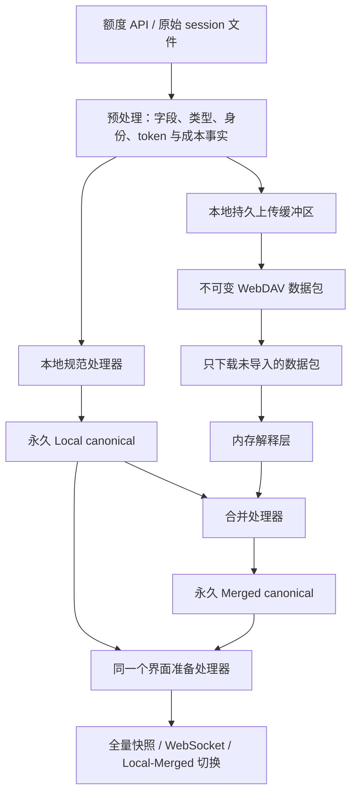

# 数据采集、规范处理、云同步与界面交付

当前工作区目标为本地合同 22、云合同 5。最近成功发布的 v1.5.29 为本地 21、云 4；这里描述运行时源代码，生成的 release 文件须等待明确发布后再更新。

## 数据流

Local 与 Merged 使用完全相同的记录类型、字段、单位、存储结构和准备逻辑。视图选择器在记录载荷之外。同步包 ID、上传状态和下载回执独立保存，不将云包、日期或分片关联写入规范历史。

## 采集与提交

API 提供 5h/7d 百分比和重置时间，session 日志提供事件 token。沿用当前事件身份、账号归因和成本公式；已保存的成本不会因下载或新价格规则重新计价。

预处理结果分流至上传缓冲区和内存处理器。本地规范记录、对应 Merged 更新、缓冲记录、源文件检查点在同一 SQLite 事务提交。解析事件没有单独的持久队列。检查点只保留增量解析需要的偏移、上下文、未完成行和前缀校验摘要。

原文件已读部分未变时增量读取；发生替换、截断或前缀变化时从头解析，视为新文件输入。已提交的事件身份去重，旧规范历史不会因为源文件修改或消失而删除。

## 额度范围合并

5h 和 7d 独立处理。规范额度保留原值、接受值或拒绝标记、倍率、套餐、重置信息以及 Unix 秒范围。相同且兼容的观测可延长范围。

云端新包可能包含较早发生的观测。合并器只调整受影响范围：50% 的 10:00–11:00 范围收到 10:30 的 51% 点后，拆成 10:00–10:29:59 的 50%、10:30:00 的 51%、10:30:01–11:00 的 50%。空片段丢弃；明确点优先于推断范围；重复身份不重复应用；同一时刻冲突点保留先提交的值。

随后用同一个界面准备处理器更新受影响的额度区间及成本归属。token 事件只按身份合并，token 总量和已存金额保持不变。无需保留全部原始云记录或完整重放历史。

## 上传缓冲区与重试

缓冲区保存在本地磁盘。最早一条剩余记录的实际入缓冲时间超过 1,800 秒后触发自动上传，不再按 UTC 半小时、日或月分包。重启后立即检查；手动上传立即刷新非空缓冲区。

上传快照不阻塞新数据采集，只清除已成功发布的记录。5h/7d 新窗口分别进入不可变缓冲条目，避免上传过程中新增窗口被一并确认。明确失败后新数据仍进入同一个缓冲区，下一次上传重新选取快照；没有独立的未来包队列。重试从 30 秒开始，指数退避上限 15 分钟。

不确定发布结果仅保留包 ID、目标和序列截止点。远端发布成功而本地确认前退出时，重启先确认该包，防止重复发布。未被本次确认的数据保留原到达时间。

按未压缩的 canonical UTF-8 JSON 字节计数；完整记录使包超过 75,000,000 字节时结束该包，该记录留在本包，后续记录进入下一包。大缓冲区只在实际上传时依次选择记录前缀。

## 云端格式与下载

`usage/v5/data/<machine>/<id>.enc` 保存压缩加密数据；`usage/v5/packages/<machine>/<id>.enc` 是成功上传后创建的不可变描述文件，记录包身份、数量及实际事件/到达范围。不存在日/月索引、历史修订或分片所有权。

下载器列出包描述文件，只获取未导入的包。下载、解码和解释在内存完成，规范结果和包回执在同一事务提交后释放载荷。不会保留远端原始缓存或磁盘临时云包。包消失不删除已经永久保存的 Merged 历史。

下载独立保持 30 分钟自动检查周期。上传失败不阻止到期的下载。逻辑 WebDAV 操作只报告一次排队/开始和一次结束，部分成功、失败或跳过均说明结果。

## 界面与诊断

`/api/dashboard` 仍提供同时包含 Local/Merged 的按账号全量 gzip 快照，`/api/dashboard/live` 提供独立序列流。两个规范数据集直接进入同一准备代码；客户端切换视图和时间范围无需再次读取历史。

运行时不再写额度/token 规范 JSONL 备份。`saveRawQuotaResponses` 默认关闭，启用后仅记录额度 API 响应正文及时间、账号、HTTP 状态，包括校验失败的响应；不记录请求凭据、token 事件、成本事件或处理结果。可用 `--raw-quota-log` 指定文件。诊断写入失败不阻断规范处理。旧 JSONL 文件保留，正常运行不读取。

## 迁移

本地 22 将原有 Local/Merged 结果转换为同构永久规范记录，保留已保存的成本与额度决策；旧事件队列中尚未形成账本的输入先转换，再删除旧源事件、事实、发布和远端缓存布局。

旧发布历史暂存为待核对候选。第一次联网同步先与已转换的云历史核对，只保留未上传内容；离线启动和失败重试不会丢失候选。

云 5 一次性将 v4 全部历史直接整理为按时间排序的数据包，成功提交合同标记后再清理旧云结构。迁移用临时排序空间不属于正常下载缓存。失败保留原始来源且可重试，已发布中间迁移仍顺序保留。旧客户端须升级。

合同变更源于规范数据持久结构、临时上传缓冲与包发现方式变化；保留旧日/月所有权结构无法移除原同步复杂度。迁移不因为日常规则调整重算历史成本，也不清空有效历史或界面结果。
