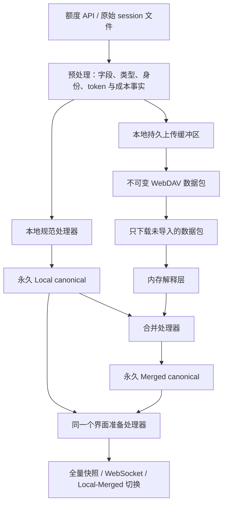

# 数据采集、规范处理、云同步与界面交付

当前工作区目标为本地合同 25、云合同保持 5。最近成功发布的 v1.5.33 为本地 24、云 5；这里描述运行时源代码，生成的 release 文件须等待明确发布后再更新。

## 数据流

Local 与 Merged 使用完全相同的记录类型、字段、单位、存储结构和准备逻辑。永久历史采用 `canonical_quota`、`canonical_tokens` 两张强类型表，以 `dataset` 列选择 Local/Merged；两者通过同一个读取映射和准备处理器使用。核心业务字段不再保存为 JSON，只有未知扩展元数据允许使用可空 `extras_json`。视图选择器在记录载荷之外。同步包 ID、上传状态和下载回执独立保存，不将云包、日期或分片关联写入规范历史。

## 采集与提交

API 提供 5h/7d 百分比和重置时间，session 日志提供事件 token。沿用当前事件身份、账号归因和成本公式；已保存的成本不会因下载或新价格规则重新计价。

预处理结果分流至上传缓冲区和内存处理器。本地 quota 操作逐条提交，失败时保留已完成部分并终止剩余处理。Token 源采集的本地规范记录、对应 Merged 更新、缓冲记录、源文件检查点在同一 SQLite 事务提交。解析事件没有单独的持久队列。检查点只保留增量解析需要的偏移、上下文、未完成行和前缀校验摘要。

原文件已读部分未变时增量读取；发生替换、截断或前缀变化时从头解析，视为新文件输入。已提交的事件身份去重，旧规范历史不会因为源文件修改或消失而删除。

## 额度范围合并

新增 0% 合并规则：同一数据集、账号和窗口中，相邻记录的额度均为 0%，套餐与倍率相同时，允许重置时间不同；合并范围保存时间上最新观测的重置时间，而非数值最大的时间。迟到旧点不能覆盖较新重置值，非零额度仍要求重置时间完全一致；中间出现不同额度、套餐或倍率时不跨越合并，时间空隙沿用现有规则。

本地迁移 25 按明确请求合并现存 Local/Merged 的零额度历史，保留最早身份与元数据，并使用最新观测的重置时间；只将受影响账号加入正常额度界面准备队列。不重放原始历史、不重新计价、不清空全局交付流，不改动上传缓冲、收据或解析检查点。估算可移除约 71.3% 额度记录，保留旧存储无法获得该显著缩减，因此新增本地合同步骤；云合同仍为 5。转换沿用数据库备份和迁移日志，事务失败可恢复重试，不自动压缩数据库。

5h 和 7d 按账号独立处理。新规范额度只保存已接受的原值、倍率、套餐、重置信息以及 Unix 秒范围，不再写入 `continuous`。相同且兼容的观测可延长范围。按明确请求，待发布迁移 24 将历史散点视为原始观测重新预处理，再顺序合并；运行时继续读取规范接受点。

本地原始观测在 `QuotaPreprocessor` 中只预处理一次。首次有效观测直接接受；`resetAt` 与上次接受值不同（包括向前、向后或空值变化）即视为重置，直接接受当前点，丢弃待确认点，不生成额外的零值点。同一重置时间内，低于上次接受值的观测只在内存暂存，不写规范历史或上传缓冲。时间更晚且数值不低于暂存点的有效本地观测确认两点；继续下降时用新点继续等待，重复或更早的观测不能确认暂存点。暂存点只存在于预处理器内，按本地账号和窗口隔离，进程退出即丢弃。接受结果分流到上传缓冲及 Local/Merged；本地 quota 写入逐条提交，异常时控制台打印堆栈并终止本次剩余处理，保留已完成写入和预处理状态，不恢复 pending、不自动重试或补写。重置前后的观测不组成有效额度增量区间。

云端 quota 已经由来源机器预处理，导入时直接转换成 canonical 点并进行范围合并，不再执行下降确认，不读取或更新本地采样状态，也不维护 Merged 采样状态或待确认点。迟到云端观测仅参与范围合并，不会确认或替换本地待确认点。

规范记录不再生成或使用 `resetBoundary`；历史中已推算的重置零点仍保留，新采样不再补零。本地合同 24 在同一事务中修正字段位掩码、删除旧数据库的 `continuous`、`reset_boundary` 列和扩展 JSON 中可能残留的旧字段，并执行明确要求的历史预处理与合并；新建表不再包含该列，读写代码不再保留兼容占位。

额度点统一按时间排序；同一账号、同一窗口、同一时刻有不同数值时，数值较小的点在前。该规则适用于采样恢复、规范记录读取和界面准备，不针对补零点设置特殊优先级；相同数值无需额外区分先后。

云端新包可能包含较早发生的观测。新点落在已有范围内（含端点）时直接丢弃，无论状态是否相同，不拆分或覆盖已有范围。新点位于范围外时，检查同账号、同窗口的最近前驱和后继；`usedPercent`、`multiplier`、`resetAt`、`plan` 全部相同则延长对应范围，否则保留独立点，不跨越不同状态合并。50% 的 10:00–11:00 范围收到 10:30 的 51% 点后保持不变；收到 09:30 的兼容 50% 点则向前延长到 09:30。Quota 不做前置 ID 去重，相同 ID 的不同值仍进入点／范围合并；下降确认只发生在本地原始观测预处理阶段。此规则用于新处理的输入，保留已存历史，不重放或迁移。

`canonical_seen` 仅保存 cost/token 事件的 `(view, record_key)`，Local/Merged 分别按账号及事件身份去重。Quota 的输入身份仍用于传输和上传缓冲键，但不再为每次额度观测保存持久去重登记；包回执继续阻止重复导入同一包。

按明确请求，已发布的本地合同 24 将 Local/Merged 历史散点当作原始观测，忽略旧 `continuous` 决策，按数据集、账号、窗口隔离并从早到晚执行下降确认、继续下降替换待确认点、重置直接接受等预处理规则；同一时间按额度值升序，重复时间不能确认下降，最终未确认点丢弃。已有范围的两个端点作为相同值的重复观测证据，不补造中间采样。接受记录再依次合并，兼容条件为 `usedPercent`、`multiplier`、`resetAt`、`plan` 全部相同。冲突优先保留较早数据：较晚的不兼容记录起点落入已保留范围时，整条弃用，包括可能超出范围的尾段；不同状态但不重叠的记录分别保留。合并保留最早记录的身份、元数据及起点，仅延长终点并删除被合并记录。

仅修改后续写入无法释放已有冗余行，因此此次明确要求的历史预处理与合并纳入当前未发布的合同 24，不新增版本。转换与字段清理共用事务，失败回滚，可安全重试，不修改上传缓冲、包回执和 token 历史。接受结果改变时清理旧本地预处理检查点，通过持久迁移待办在整条迁移链完成后统一请求一次界面准备和成本归属重建，不再重复执行旧采样或投影重放；仅兼容合并不触发重建。释放页供 SQLite 复用，不执行 VACUUM，数据库文件不会因此立即缩小。

随后用同一个界面准备处理器更新受影响的额度区间及成本归属。token 事件只按身份合并，token 总量和已存金额保持不变。无需保留全部原始云记录或完整重放历史。

## 上传缓冲区与重试

缓冲区保存在本地磁盘。最早一条剩余记录的实际入缓冲时间超过 1,800 秒后触发自动上传，不再按 UTC 半小时、日或月分包。重启后立即检查；手动上传立即刷新非空缓冲区。

上传快照不阻塞新数据采集，只清除已成功发布的记录。5h/7d 新窗口分别进入不可变缓冲条目，避免上传过程中新增窗口被一并确认。明确失败后新数据仍进入同一个缓冲区，下一次上传重新选取快照；没有独立的未来包队列。重试从 30 秒开始，指数退避上限 15 分钟。

不确定发布结果仅保留包 ID、目标和序列截止点。远端发布成功而本地确认前退出时，重启先确认该包，防止重复发布。未被本次确认的数据保留原到达时间。

按未压缩的 canonical UTF-8 JSON 字节计数；完整记录使包超过 75,000,000 字节时结束该包，该记录留在本包，后续记录进入下一包。大缓冲区只在实际上传时依次选择记录前缀。

## 云端格式与下载

`usage/v5/data/<machine>/<id>.enc` 保存压缩加密数据；`usage/v5/packages/<machine>/<id>.enc` 是成功上传后创建的不可变描述文件，记录包身份、数量及实际事件/到达范围。不存在日/月索引、历史修订或分片所有权。

下载器列出包描述文件，只获取未导入的包。下载、解码和解释在内存完成，规范结果和包回执在同一事务提交后释放载荷。不会保留远端原始缓存或磁盘临时云包。包消失不删除已经永久保存的 Merged 历史。

下载独立保持 30 分钟自动检查周期。上传失败不阻止到期的下载。逻辑 WebDAV 操作只报告一次排队/开始和一次结束，部分成功、失败或跳过均说明结果。

## 界面与诊断

`/api/dashboard` 仍提供同时包含 Local/Merged 的按账号全量 gzip 快照，`/api/dashboard/live` 提供独立序列流。两个规范数据集直接进入同一准备代码；客户端切换视图和时间范围无需再次读取历史。

运行时不再写额度/token 规范 JSONL 备份。`saveRawQuotaResponses` 默认关闭，启用后仅记录额度 API 响应正文及时间、账号、HTTP 状态，包括校验失败的响应；不记录请求凭据、token 事件、成本事件或处理结果。可用 `--raw-quota-log` 指定文件。诊断写入失败不阻断规范处理。旧 JSONL 文件保留，正常运行不读取。

## 迁移

本地 23 将已发布合同 22 的 JSON 规范记录转换为强类型 SQL 列，逐条验证身份、时间、额度决策、Token 和已存成本，并核对分数据集/类型数量后再移除旧表。合同更新是已存表示转换所必需，云合同保持 5。保留所有已发布的顺序迁移；22 的旧布局初始化与转换辅助函数仅供迁移使用。

本地 24 按明确请求物理删除 `continuous` 和 `reset_boundary` 列，并调整 presence/integer 位掩码，不新增接受标记、表或替代列。历史点的保留由上述时间顺序预处理重新决定，不再直接使用旧接受／拒绝决策。停止读写不能满足物理删列及历史压缩要求，因此需要转换现有数据库；失败时整个事务回滚，恢复原记录、列和位掩码，可安全重试。保留记录的额度值、数值类型与时间原文不变，成本和传输状态保留；接受结果变化按上述方式统一刷新准备数据。已发布的 23 迁移绑定其冻结字段映射，保证旧版本顺序升级后再统一执行 24。

待发布的本地 24 同时将 `canonical_seen` 转换为仅含 `(view, record_key)` 的 cost/token 登记表，迁移保留全部成本身份，删除 quota 身份、旧 `kind` 列及旧表和索引。仅停止写入不能清除已存的逐采样 quota ID，因此按明确请求转换现有登记表；该身份登记表清理本身不删除 canonical 额度历史或触发历史重算。

转换沿用数据库备份和迁移日志，事务失败保留原表，合同标记发布前中断也能恢复后重试。上传缓冲序列、到达时间、不确定上传状态、包收据、解析检查点及成本身份保持不变，不重新计价。本地 23 的表示转换不重放历史；24 仅额外执行明确要求的 quota 预处理及接受结果变化后的界面刷新。保留释放页面供 SQLite 复用，不自动压缩数据库；自定义数据路径及旧 JSONL 均不改变。

本地 22 将原有 Local/Merged 结果转换为同构永久规范记录，保留已保存的成本与额度决策；旧事件队列中尚未形成账本的输入先转换，再删除旧源事件、事实、发布和远端缓存布局。

旧发布历史暂存为待核对候选。第一次联网同步先与已转换的云历史核对，只保留未上传内容；离线启动和失败重试不会丢失候选。

云数据已离线转换完成，运行时仅支持云契约 5，不再包含云迁移注册表、旧版云读取器或转换代码。旧契约及缺少标记的非空目录会被拒绝且不改写；空目录可以初始化为契约 5。本地迁移仍按顺序保留。

合同变更源于规范数据持久结构、临时上传缓冲与包发现方式变化；保留旧日/月所有权结构无法移除原同步复杂度。迁移不因为日常规则调整重算历史成本，也不清空有效历史或界面结果。
